# QA SCENARIO MODEL: holatlar va o'tishlar

Sana: 2026-11-14
Maqsad: test case'larni holat o'tishlaridan generatsiya qilish. Har ruxsat etilgan o'tish ijobiy test, har ruxsat etilmagan o'tish salbiy test.

Belgilar:
- ✅ ruxsat etilgan o'tish (ijobiy test)
- ⛔ ruxsat etilmagan o'tish (salbiy test: bajarib bo'lmasligi kerak)
- [K] kodda tasdiqlanishi shart (model hujjatlardan tuzilgan: STATE.md, AUDIT_REPORT.md, FINAL_AUDIT_REPORT.md)
- [Q] qaror kerak (kutilgan xulq aniq emas)
- Qatlam: API (pytest + httpx), WEB (Playwright), ADM (Playwright, admin panel), BOT (pytest + aiogram mock, 1 ta haqiqiy test bot smoke)

## 1. Umumiy hisob

| # | Mashina | Kod | Holatlar | Mumkin juftlik N*(N-1) | Ruxsat etilgan o'tish | Salbiy test |
|---|---|---|---|---|---|---|
| M1 | Identifikatsiya (rol) | ID | 5 | 20 | 9 | 6 |
| M2 | Kontent nashri | CT | 3 | 6 | 4 | 4 |
| M3 | Autopilot navbati | IN | 7 | 42 | 12 | 8 |
| M4 | Kino buyurtmasi | RQ | 4 | 12 | 4 | 3 |
| M5 | Shikoyat | RP | 3 | 6 | 2 | 2 |
| M6 | Sharh | RV | 2 | 2 | 3 | 5 |
| M7 | Broadcast | BC | 4 | 12 | 4 | 4 |
| M8 | Bot dialog (FSM) | FS | 4 | 12 | 9 | 5 |
| M9 | Davom ettirish (sayt) | CW | 4 | 12 | 10 | 3 |
| M10 | Tizim sog'ligi | IF | 4 | 12 | 6 | 0 (xato kiritish) |
| M11 | Bot ekranlari | NV | 19 | graf | 28 | 6 |
| | JAMI | | 59 | | 91 | 46 |

Qo'shimcha: RBAC matritsa 12 resurs x 4 rol = 48 katak (AC).
Bazaviy case soni: 91 + 46 + 48 = 185. Bir o'tish bir nechta interfeysda tekshirilsa (masalan ban: API + sayt + bot), 250 dan oshadi.
Mumkin juftlikning ruxsat etilganlaridan tashqari qismi salbiy test nomzodi: faqat xavfli bo'lganlari tanlangan.

## 2. Rollar va interfeyslar

Rollar (principal): Guest (login yo'q), User, Banned (ban qilingan user), Admin, Bot-service (faqat X-Bot-Secret).
Interfeyslar: Sayt (:3000), Admin panel (:3001), Telegram bot, Backend API (:8000).
Botda har Telegram foydalanuvchisi avtomatik bot-user, shuning uchun botda rollar: yangi user, mavjud user, banned, admin.

## 3. Holat mashinalari

### M1. Identifikatsiya (ID)

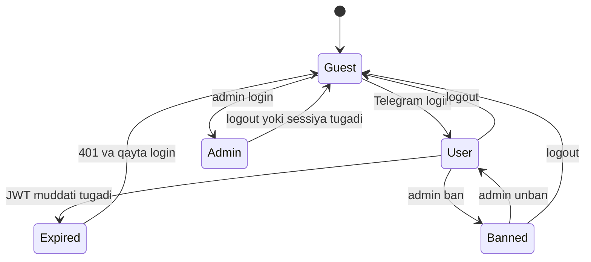

| ID | O'tish | Trigger | Kutilgan natija | Qatlam |
|---|---|---|---|---|
| ID-01 ✅ | Guest -> User | Telegram login (Mini App initData yoki Login Widget) | JWT beriladi, UserModel bor/yaratiladi | API, WEB |
| ID-02 ✅ | User -> Guest | logout | token tozalanadi, shaxsiy sahifalar login so'raydi | WEB |
| ID-03 ✅ | User -> Expired | JWT muddati tugaydi | himoyalangan API 401 | API |
| ID-04 ✅ | Expired -> Guest | 401 qaytgach | UI login taklif qiladi, qotib qolmaydi | WEB |
| ID-05 ✅ | User -> Banned | admin ban | API 403; botda message, callback, inline bloklanadi (kesh <=60s) | API, BOT, ADM |
| ID-06 ✅ | Banned -> User | admin unban | <=60s ichida bot ochiladi, API 200 | API, BOT |
| ID-07 ✅ | Banned -> Guest | logout | token tozalanadi | WEB |
| ID-08 ✅ | Guest -> Admin | admin login | admin JWT, panel ochiladi | ADM |
| ID-09 ✅ | Admin -> Guest | logout / sessiya tugashi | admin sahifalar /login ga yo'naltiradi | ADM |
| ID-N1 ⛔ | Guest -> Admin | parolsiz yoki noto'g'ri parol | rad, token berilmaydi | ADM, API |
| ID-N2 ⛔ | User -> Admin | user tokeni bilan admin panel/API | 403, panel sahifalari ochilmaydi | API, ADM |
| ID-N3 ⛔ | Guest -> User | soxta initData / noto'g'ri HMAC | rad | API |
| ID-N4 ⛔ | Banned -> User | qayta login qilib ban'dan chiqish | ban saqlanadi | API, WEB |
| ID-N5 ⛔ | Expired -> yozish | eskirgan token bilan yozuvchi API | 401 | API |
| ID-N6 ⛔ [Q] | Admin -> Banned | admin akkauntini ban qilish | kutilgan xulq aniqlansin | API, ADM |

### M2. Kontent nashri (CT)

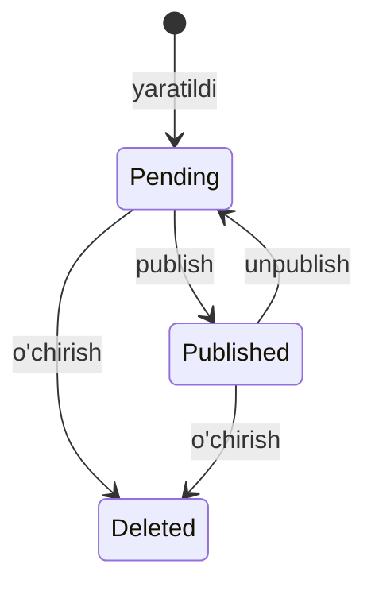

| ID | O'tish | Trigger | Kutilgan natija | Qatlam |
|---|---|---|---|---|
| CT-01 ✅ | Pending -> Published | admin publish yoki autopilot final_check | ommaviy sahifa, qidiruv, katalog, botda ko'rinadi | API, WEB, BOT |
| CT-02 ✅ | Published -> Pending | unpublish | ommaviy joylardan yo'qoladi (kesh <=60s) | API, WEB |
| CT-03 ✅ | Pending -> Deleted | o'chirish (tasdiq dialogi) | cascade, yetim yozuv yo'q | ADM, API |
| CT-04 ✅ | Published -> Deleted | o'chirish | qidiruv/kesh/Redis tozalanadi, havola 404 | ADM, API |
| CT-N1 ⛔ | Pending Guest/User'ga ko'rinishi | detail URL, ro'yxat, qidiruv, recommendations, sitemap, facet soni, kesh | 404 / ko'rinmaydi | API, WEB |
| CT-N2 ⛔ | Deleted -> har qanday | qayta tiklanish | mumkin emas, 404 | API |
| CT-N3 ⛔ | Published qism, Pending serial ostida | yetim holat | mumkin emas | API |
| CT-N4 ⛔ | Kesh kaliti | admin pending'ni ko'rgach, tokensiz so'rov | pending ko'rinmaydi | API |

Invariant: Guest va User faqat Published ko'radi; Admin hammasini ko'radi. Serial Published bo'ladi S1:E1 final_check'dan o'tgach.

### M3. Autopilot navbati (IN)

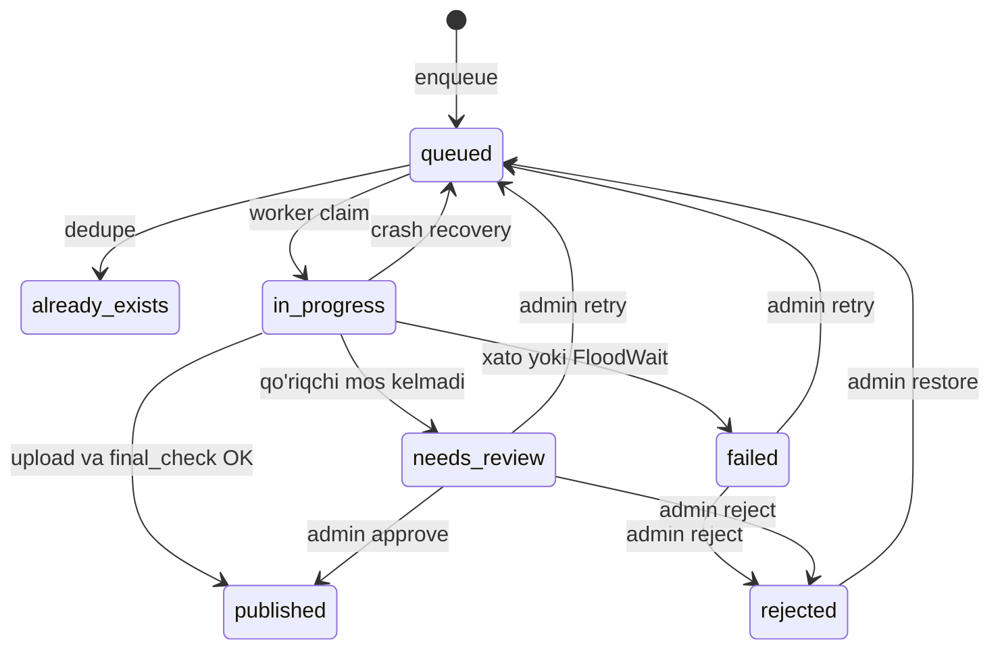

| ID | O'tish | Trigger | Kutilgan natija |
|---|---|---|---|
| IN-01 ✅ | queued -> already_exists | dedupe (TMDb ID yoki kod) | element yozilmaydi, takror yo'q |
| IN-02 ✅ | queued -> in_progress | worker claim (SKIP LOCKED) | bitta worker oladi |
| IN-03 ✅ | in_progress -> published | upload + final_check OK | DB'ga atomik yozuv (movie/series/translation) |
| IN-04 ✅ | in_progress -> needs_review | fayl nomi, caption, qism raqami, davomiylik, TMDb qism soni mos kelmadi | avtomatik nashr yo'q |
| IN-05 ✅ | in_progress -> failed | xato, 120s FloodWait breaker | sabab saqlanadi, yarim yozuv yo'q (rollback) |
| IN-06 ✅ | in_progress -> queued | crash recovery (qotib qolgan) | qayta olinadi, takror yo'q |
| IN-07 ✅ | failed -> queued | admin retry | |
| IN-08 ✅ | failed -> rejected | admin reject | /rejected sahifada ko'rinadi |
| IN-09 ✅ | needs_review -> published | admin approve | CT-01 ga o'tadi |
| IN-10 ✅ | needs_review -> rejected | admin reject | |
| IN-11 ✅ | needs_review -> queued | admin retry | |
| IN-12 ✅ [Q] | rejected -> queued | admin restore | bor-yo'qligi aniqlansin |
| IN-N1 ⛔ | queued -> published | final_check'ni o'tkazib yuborish | mumkin emas |
| IN-N2 ⛔ | published -> queued/in_progress | qayta ingest | takroriy yozuv bo'lmasin |
| IN-N3 ⛔ | already_exists -> in_progress | | mumkin emas |
| IN-N4 ⛔ | failed -> published | to'g'ridan | mumkin emas |
| IN-N5 ⛔ | rejected -> published | review'siz | mumkin emas |
| IN-N6 ⛔ | in_progress ikki worker | bir elementni ikki marta claim | mumkin emas |
| IN-N7 ⛔ | in_progress'da abadiy qolish | crash'dan keyin | tiklanadi (IN-06) |
| IN-N8 ⛔ | qism raqami/fayl nomi/caption mos kelmagan qism published bo'lishi | Kaiju holati | needs_review'ga tushadi; S1:E1 yo'q serial published bo'lmaydi |

Statuslar nomi [K]: "queued", "pending" nomlari frontend tipida va backendda mos kelishi tekshirilsin.

### M4. Kino buyurtmasi (RQ)

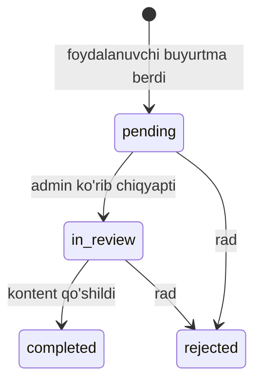

| ID | O'tish | Kutilgan natija |
|---|---|---|
| RQ-01 ✅ | pending -> in_review | admin panelda status o'zgaradi |
| RQ-02 ✅ | pending -> rejected | buyurtmachiga xabar [K] |
| RQ-03 ✅ | in_review -> completed | buyurtmachiga xabar [K] |
| RQ-04 ✅ | in_review -> rejected | |
| RQ-N1 ⛔ | completed -> pending | |
| RQ-N2 ⛔ | rejected -> completed | |
| RQ-N3 ⛔ [Q] | pending -> completed (in_review'siz) | ruxsat bormi |

### M5. Shikoyat (RP)

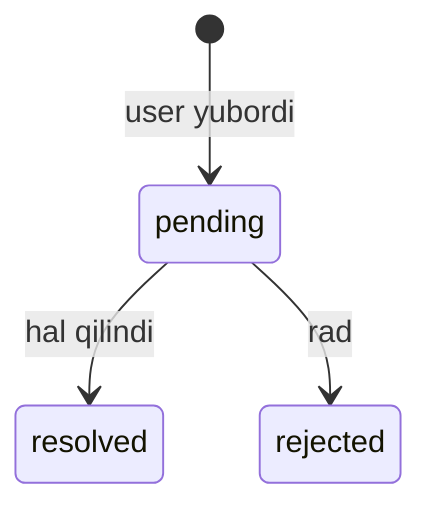

| ID | O'tish | Kutilgan natija |
|---|---|---|
| RP-01 ✅ | pending -> resolved | admin panel va foydalanuvchiga xabar [K] |
| RP-02 ✅ | pending -> rejected | |
| RP-N1 ⛔ [Q] | resolved -> pending | qayta ochish bormi |
| RP-N2 ⛔ [Q] | rejected -> resolved | |

Invariant: shikoyat telegram_user_id bilan keladi va admin panelda ko'rinadi.

### M6. Sharh (RV)

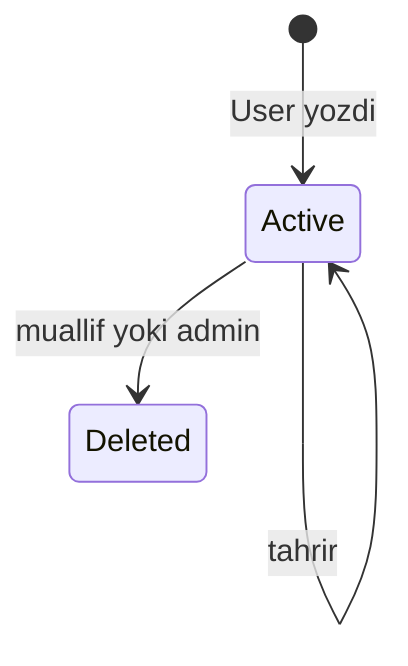

| ID | O'tish | Kutilgan natija |
|---|---|---|
| RV-01 ✅ | [*] -> Active | baho 1-10 + matn, reyting qayta hisoblanadi |
| RV-02 ✅ | Active -> Active | tahrir, reyting qayta hisoblanadi |
| RV-03 ✅ | Active -> Deleted | atomik reyting qayta hisoblash; oxirgi sharh o'chsa reyting null, ZeroDivision yo'q |
| RV-N1 ⛔ | Guest yoki Banned sharh yozishi | 401 / 403 |
| RV-N2 ⛔ | boshqa user sharhini tahrirlash/o'chirish | 403 (IDOR) |
| RV-N3 ⛔ | Deleted -> Active | mumkin emas |
| RV-N4 ⛔ [Q] | bir user bir kontentga ikkinchi sharh | yangilanadimi yoki rad |
| RV-N5 ⛔ | botda "/cancel" yoki boshqa komanda matni sharh bo'lib saqlanishi | saqlanmaydi |

### M7. Broadcast (BC)

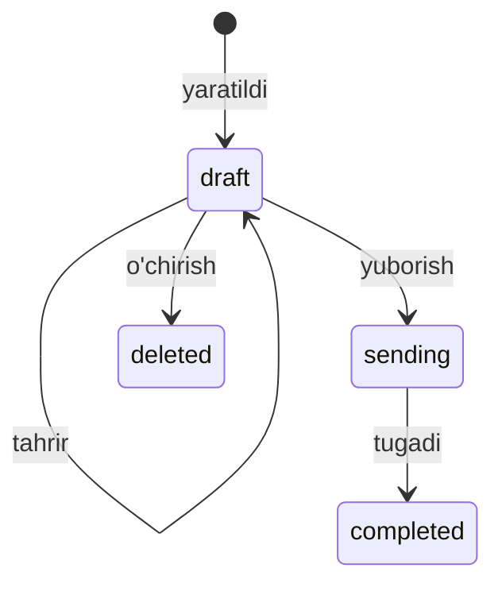

| ID | O'tish | Kutilgan natija |
|---|---|---|
| BC-01 ✅ | draft -> draft | tahrir saqlanadi |
| BC-02 ✅ | draft -> sending | yuborish boshlanadi |
| BC-03 ✅ | sending -> completed | yetkazilganlar soni to'g'ri |
| BC-04 ✅ | draft -> deleted | |
| BC-N1 ⛔ | sending/completed tahrirlanishi | rad |
| BC-N2 ⛔ | takroriy yuborish (ikki marta bosish) | ikkinchi yuborish bo'lmaydi |
| BC-N3 ⛔ [Q] | sending/completed o'chirilsa nima bo'ladi | aniqlansin |
| BC-N4 ⛔ | botni bloklagan yoki banned userga yetkazish xatosi | butun broadcast yiqilmaydi |

Test faqat TEST bot va test userga.

### M8. Bot dialog (FSM)

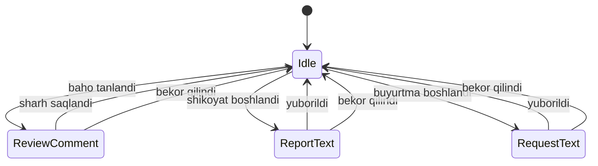

| ID | O'tish | Kutilgan natija |
|---|---|---|
| FS-01 ✅ | Idle -> ReviewComment | "fikringizni yozing" |
| FS-02 ✅ | ReviewComment -> Idle (saqlandi) | sharh DB'da |
| FS-03 ✅ | ReviewComment -> Idle (/cancel, cancel, bekor qilish) | sharh saqlanmaydi, state.clear() |
| FS-04 ✅ | Idle -> ReportText | |
| FS-05 ✅ | ReportText -> Idle (yuborildi) | telegram_user_id bilan |
| FS-06 ✅ | ReportText -> Idle (bekor) | |
| FS-07 ✅ | Idle -> RequestText | |
| FS-08 ✅ | RequestText -> Idle (yuborildi) | |
| FS-09 ✅ | RequestText -> Idle (bekor) | |
| FS-N1 ⛔ | waiting holatda /cancel, /start, /katalog matni ma'lumot sifatida saqlanishi | har waiting holat uchun |
| FS-N2 ⛔ | bir FSM ichida boshqasini boshlash | state jimgina ustiga yozilmasin |
| FS-N3 ⛔ | bot qayta ishga tushgach state yo'qolishi | user "qotib" qolmaydi [K: storage turi] |
| FS-N4 ⛔ | bo'sh, juda uzun (limitdan oshgan), emoji/maxsus belgili matn | to'g'ri rad yoki qabul |
| FS-N5 ⛔ | eskirgan tugma bosilishi | spinner qotmaydi |

### M9. Davom ettirish / tomosha tarixi (CW)

Qaror: tizimga kirgan user uchun yagona manba server; localStorage faqat mehmon uchun, kirgan userga ko'chirilmaydi va o'qilmaydi.

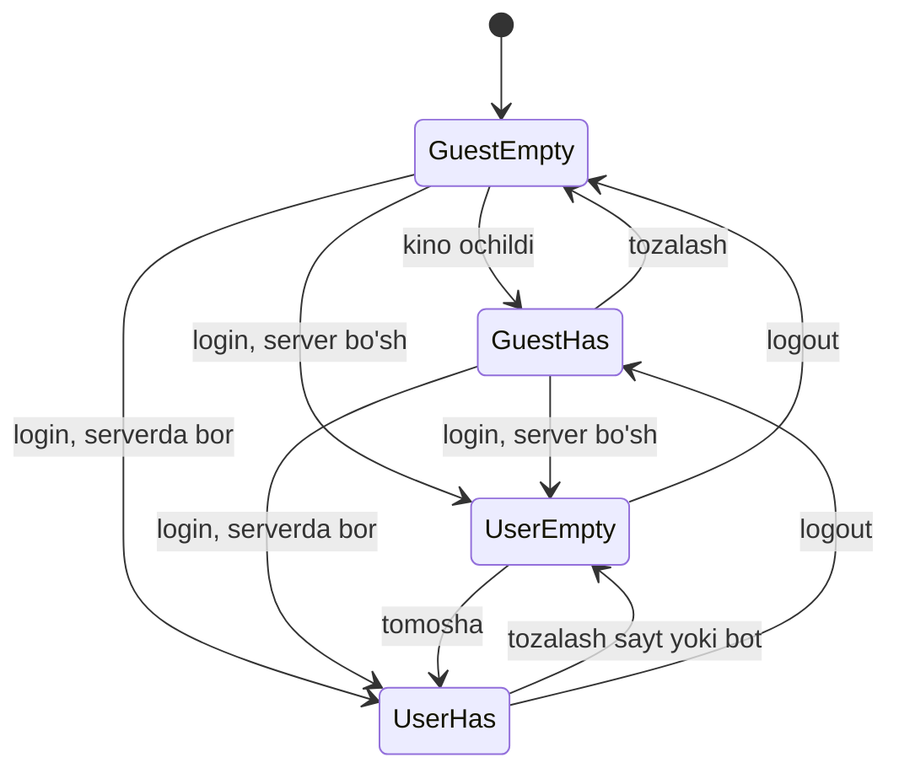

| ID | O'tish | Kutilgan natija |
|---|---|---|
| CW-01 ✅ | GuestEmpty -> GuestHas | localStorage'ga yoziladi, F5 dan keyin saqlanadi |
| CW-02 ✅ | GuestHas -> GuestEmpty | tozalanadi |
| CW-03..06 ✅ | Guest -> User (4 kombinatsiya) | ro'yxat serverdan; localStorage tegilmaydi |
| CW-07 ✅ | UserEmpty -> UserHas | server yozadi |
| CW-08 ✅ | UserHas -> UserEmpty | sayt yoki bot orqali tozalash, F5 dan keyin bo'sh |
| CW-09 ✅ | UserEmpty -> GuestEmpty | logout |
| CW-10 ✅ | UserHas -> GuestHas | logout: mehmon ro'yxati qaytadi (qaror oqibati) |
| CW-N1 ⛔ | login paytida localStorage serverga ko'chirilishi yoki o'chirilishi | bo'lmaydi |
| CW-N2 ⛔ | UserEmpty'da mehmon ro'yxati ko'rinishi | ko'rinmaydi |
| CW-N3 ⛔ | botda tarix tozalansa saytda F5 dan keyin eski ro'yxat | bo'sh bo'ladi (kesh yo'q) |

### M10. Tizim sog'ligi (IF): xato kiritish holatlari

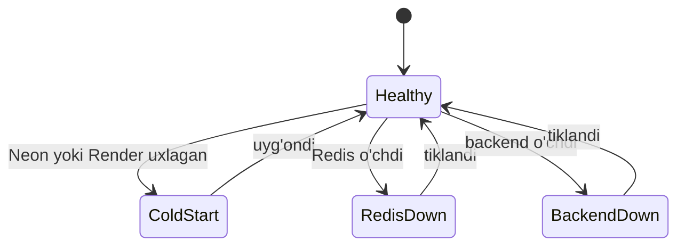

| ID | O'tish | Sayt | Bot | Admin panel |
|---|---|---|---|---|
| IF-01 ✅ | Healthy -> ColdStart | loading, keyin ochiladi | "topilmadi" EMAS, "server kechikdi, qayta urinib ko'ring" | loading |
| IF-02 ✅ | ColdStart -> Healthy | normal | normal | normal |
| IF-03 ✅ | Healthy -> RedisDown | sekinroq, xato yo'q | ishlaydi | ishlaydi |
| IF-04 ✅ | RedisDown -> Healthy | normal | normal | normal |
| IF-05 ✅ | Healthy -> BackendDown | tushunarli xato sahifa | server kechikdi xabari; ban holati keshdan (fail-open + stale-while-error) | xato holati, qotmaydi |
| IF-06 ✅ | BackendDown -> Healthy | o'zi tiklanadi | o'zi tiklanadi | o'zi tiklanadi |

### M11. Bot ekranlari (NV)

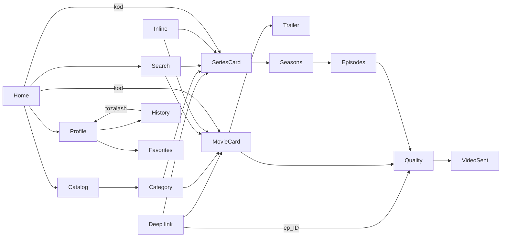

Ekranlar (19): Home, Catalog, Category, MovieCard, SeriesCard, Seasons, Episodes, Quality, VideoSent, Search, Inline, Profile, History, Favorites, Trailer, Gate (majburiy obuna), Blocked, NotFound, ServerDelay.

| ID | O'tish |
|---|---|
| NV-01 | Home -> Catalog |
| NV-02 | Catalog -> Category |
| NV-03 | Category -> MovieCard |
| NV-04 | Category -> SeriesCard |
| NV-05 | Home -> Search |
| NV-06 | Search -> MovieCard |
| NV-07 | Search -> SeriesCard |
| NV-08 | Inline -> MovieCard |
| NV-09 | Inline -> SeriesCard |
| NV-10 | Home -> MovieCard (kod yuborildi: 1428, #1428) |
| NV-11 | Home -> SeriesCard (kod yuborildi) |
| NV-12 | deep link (/start KOD) -> MovieCard |
| NV-13 | deep link -> SeriesCard |
| NV-14 | deep link (/start ep_ID) -> Quality |
| NV-15 | MovieCard -> Trailer |
| NV-16 | MovieCard -> Quality |
| NV-17 | SeriesCard -> Seasons |
| NV-18 | Seasons -> Episodes |
| NV-19 | Episodes -> Quality |
| NV-20 | Quality -> VideoSent (480p / 720p / 1080p, har biri) |
| NV-21 | Home -> Profile |
| NV-22 | Profile -> History |
| NV-23 | History -> Profile (tarixni tozalash tasdiqlangach) |
| NV-24 | Profile -> Favorites |
| NV-25 | har qanday -> Gate (obuna yo'q) |
| NV-26 | Gate -> oldingi ekran (obuna bo'ldi) |
| NV-27 | har qanday -> NotFound (faqat haqiqiy 404) |
| NV-28 | har qanday -> ServerDelay (timeout yoki ulanish xatosi), qayta urinish -> oldingi ekran |

"Orqaga" tugmasi har ekranda: parametrlangan test NV-B.

Salbiy:
- NV-N1 ⛔ banned: message bloklanadi
- NV-N2 ⛔ banned: callback bloklanadi
- NV-N3 ⛔ banned: inline qidiruv bloklanadi
- NV-N4 ⛔ eskirgan yoki ikki marta bosilgan tugma (spinner qotmaydi, parallel so'rov yaratilmaydi)
- NV-N5 ⛔ mavjud bo'lmagan kod -> NotFound, timeout -> ServerDelay ("topilmadi" faqat 404 da)
- NV-N6 ⛔ obunasiz user kontentga o'tolmaydi (Gate)

## 4. RBAC matritsa (AC)

Kutilgan natija. [Q] = aniqlansin.

| # | Resurs | Guest | User | Banned | Admin |
|---|---|---|---|---|---|
| AC-1 | Ommaviy sahifalar (bosh, katalog, kino, serial, qidiruv, aktyorlar, to'plamlar) | ✅ | ✅ | ✅ [Q] | ✅ |
| AC-2 | Ommaviy API (published ro'yxat, qidiruv) | ✅ | ✅ | ✅ [Q] 403 yoki mehmon | ✅ |
| AC-3 | Pending kontent (URL, API, qidiruv, sitemap) | 404 | 404 | 404 | ✅ |
| AC-4 | Shaxsiy sahifalar (/profile, /history, /subscriptions, /notifications, /achievements) | login ga | ✅ | ⛔ | ✅ [Q] |
| AC-5 | Yozuvchi user API (review, favorites, history, subscribe, report) | 401 | ✅ | 403 | ✅ [Q] |
| AC-6 | Admin panel sahifalari (:3001) | /login ga | /login yoki 403 | /login yoki 403 | ✅ |
| AC-7 | Admin API (CRUD, scraper, broadcasts, users, moderatsiya) | 401 | 403 | 403 | ✅ |
| AC-8 | Bot-secret endpointlar (/users/by-telegram/*) | 403 | 403 | 403 | 403 (faqat X-Bot-Secret ✅) |
| AC-9 | Bot: katalog, qidiruv, kod | ✅ | ✅ | ⛔ bloklangan | ✅ |
| AC-10 | Bot: profil, tarix, sharh, shikoyat | ✅ | ✅ | ⛔ | ✅ |
| AC-11 | Bot: inline qidiruv | ✅ | ✅ | ⛔ | ✅ |
| AC-12 | Bot: admin buyruqlari | ⛔ | ⛔ | ⛔ | ✅ |

## 5. E2E zanjirlar (mashinalar kesishuvi)

- E1 Kontent chiqishi: IN-02 -> IN-03 -> CT-01 -> NV-10 -> NV-16 -> NV-20
- E2 Pending yashirinligi: yaratish -> CT-N1 (Guest, User) -> CT-01 -> Guest ko'radi
- E3 Ban: ID-05 -> NV-N1, N2, N3 -> AC-4, AC-5 -> ID-06
- E4 Tarix: CW-01 -> CW-03..06 -> NV-22 -> NV-23 -> CW-N3
- E5 Sharh: ID-01 -> RV-01 -> RV-03 (reyting qayta hisoblanadi)
- E6 Shikoyat: FS-04 -> FS-05 -> RP-01 (admin panelda ko'rinadi, telegram_user_id bilan)
- E7 Buyurtma: FS-07 -> FS-08 -> RQ-01 -> RQ-03 (buyurtmachiga xabar)
- E8 Broadcast: BC-01 -> BC-02 -> BC-03 (test user botda oladi)
- E9 Infra: IF-05 -> NV-28 ("topilmadi" emas) -> IF-06

## 6. Test ID va qatlam xaritasi

- API: pytest + httpx ASGI, har AC katak va ID/CT/IN/RQ/RP/RV/BC o'tishlari
- WEB / ADM: Playwright, 3 rol uchun storageState (guest, user, admin); test auth faqat test muhitda imzolangan JWT bilan (kodda bypass yo'q)
- BOT: pytest-asyncio + aiogram mock; 1 ta haqiqiy test bot smoke (callback muddati, FloodWait, xabar limitlari mockda tekshirilmaydi)
- Test ID har test nomida bo'lsin: test_ID_05_user_to_banned_blocks_bot_and_api
- Rate limiter faqat test muhitda o'chiriladi (APP_ENV=testing), prod'da hech qachon

## 7. Ochiq savollar [K] / [Q]

1. publish_status qiymatlari: pending va draft ikkalasi bormi, yoki bittami.
2. Refresh token bormi (ID-04: Expired -> Guest yoki Expired -> User).
3. Admin akkauntini ban qilish mumkinmi (ID-N6).
4. Banned user ommaviy sahifa/API'ni o'qiy oladimi (AC-1, AC-2).
5. Admin ham user sifatida yozuvchi API'dan foydalana oladimi (AC-4, AC-5).
6. rejected -> queued (restore) va shikoyat/buyurtmani qayta ochish bor-yo'qligi.
7. Yuborilgan (sending/completed) broadcast o'chirilsa nima bo'ladi.
8. Ingest statuslari nomi: queued/pending mos kelishi (frontend tipi va backend).
9. Bot FSM storage turi (MemoryStorage bo'lsa, qayta ishga tushganda state yo'qoladi).
10. Bir user bir kontentga ikkinchi sharh yozsa: yangilanadimi yoki rad etiladimi.
