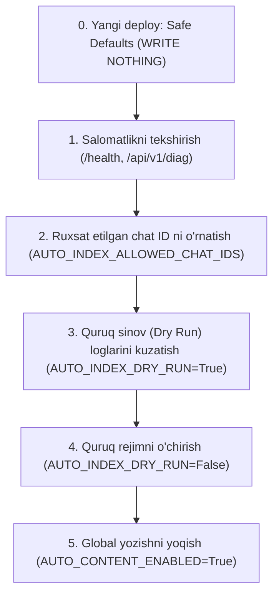

# Incident 2026-10-17: Tuzatishlar va Qayta Tiklash Bayonnomasi (FIXES.md)

Ushbu hujjat 2026-10-17 sanasidagi insident oqibatlarini bartaraf etish bo'yicha amalga oshirilgan 13 ta texnik o'zgarish, ularning konfiguratsiya bayroqlari, xavfsiz boshlang'ich qiymatlari hamda loyiha egasi (owner) uchun ishlab chiqarish (production) muhitida funksiyalarni bosqichma-bosqich faollashtirish protokolini to'liq tavsiflaydi.

---

## 1. Konfiguratsiya bayroqlari va xavfsiz boshlang'ich qiymatlar (Safe Defaults)

Barcha o'zgarishlar **Safe Defaults** qoidasiga asoslangan: yangi joylashtirishdan (fresh deployment) so'ng tizim egasi tomonidan bayroqlar aniq yoqilmaguncha **hech narsa yozilmaydi (WRITE NOTHING)**.

| Konfiguratsiya o'zgaruvchisi | Boshlang'ich qiymat (Default) | Tavsif |
| :--- | :--- | :--- |
| `AUTO_CONTENT_ENABLED` | `False` | Global yozishni to'xtatuvchi kalit (Kill Switch). `False` bo'lsa hech qanday media yozuvi, tarjima yoki qism yaratilmaydi. |
| `AUTO_INDEX_DRY_RUN` | `True` | Quruq rejim. `True` bo'lsa xabarlar bo'yicha qarorlar faqat log qilinadi, backendga hech qanday yozuv kiritilmaydi. |
| `AUTO_INDEX_ALLOWED_CHAT_IDS` | `""` (bo'sh) | Ruxsat etilgan chat identifikatorlari ro'yxati (vergul bilan ajratilgan). Bo'sh bo'lsa barcha chatlar e'tiborsiz qoldiriladi. |
| `MOVIE_RUNTIME_TOLERANCE_MINUTES` | `30` | Kino davomiyligi (fayl davomiyligi) va TMDb runtime o'rtasidagi maksimal ruxsat etilgan farq (daqiqalarda). |
| `BOT_DROP_PENDING_UPDATES` | `False` | Bot ishga tushganda kutilayotgan yangilanishlarni tashlab yubormaslik (yo'qotishlarning oldini oladi). |
| `MAX_BOT_RESTARTS` | `5` | Bot xatolik tufayli to'xtaganda supervizor tomonidan eksponentsial orqaga chekinish bilan qayta ishga tushirishlar soni. |
| `BOT_RESTART_BASE_DELAY` | `2.0` | Botni qayta ishga tushirish oralig'idagi boshlang'ich kutish vaqti (soniyalarda). |
| `OLD_STORAGE_CHANNEL_ID` | `None` / `0` | Qadimgi saqlash kanalining xabarlar sonini read-only tekshirish uchun chat ID. |

---

## 2. Loyiha egasi uchun funksiyalarni yoqishning qat'iy tartibi (Feature Activation Order)

Yangi reliz o'rnatilgandan so'ng, tizim mutlaqo passiv (hech narsa yozmaydigan) xavfsiz holatda bo'ladi. Tizimni ishlab chiqarish rejimiga o'tkazish faqat quyidagi tartibda amalga oshirilishi shart:



1. **1-qadam (Salomatlik tekshiruvi):**
   - Backend `/health` endpointiga murojaat qiling va `bot_alive: true` ekanligini tasdiqlang.
   - `/api/v1/diag` orqali ma'lumotlar bazasi ulanishini tekshiring.
2. **2-qadam (Allowlist sozlash):**
   - Faqat rasmiy kino/serial forum superguruhi ID sini `AUTO_INDEX_ALLOWED_CHAT_IDS` o'zgaruvchisiga kiriting (masalan: `-1003847632555`).
3. **3-qadam (Dry Run rejimida kuzatish):**
   - `AUTO_INDEX_DRY_RUN=True` va `AUTO_CONTENT_ENABLED=False` holatida forum guruhiga yuborilayotgan test xabarlarini kuzating.
   - Bot loglarida `[AUTO_INDEX][DRY_RUN] chat_id=... topic_id=... decision=... reason=...` formatida yozuvlar chiqishini va qoidalar to'g'ri ishlayotganini tekshiring.
4. **4-qadam (Dry Run rejimini yakunlash):**
   - Loglarda qarorlar to'g'riligiga ishonch hosil qilingach, `AUTO_INDEX_DRY_RUN=False` qilib o'zgartiring.
5. **5-qadam (Yozishni yoqish - Production Full Active):**
   - `AUTO_CONTENT_ENABLED=True` qilib o'rnating. Shundan so'ng ruxsat etilgan chat va mavzulardan kelgan to'g'ri media fayllar Admission Gate orqali tekshirilib bazaga yoziladi.

---

## 3. Checklist elementlari bo'yicha batafsil Before / After tahlili

---

### Item 1: KILL SWITCH (`AUTO_CONTENT_ENABLED`, `AUTO_INDEX_DRY_RUN`)
*Commit: `93874c8`*

- **Maqsad:** Favqulodda vaziyatlarda barcha media yozish yo'llarini (avto-indeksatsiya, scraper yuklash, seed ingest, ommaviy import) bir zumda bloklash.
- **Konfiguratsiya:** `AUTO_CONTENT_ENABLED=False` (default), `AUTO_INDEX_DRY_RUN=True` (default).

#### Kod taqqoslashi:
**Oldin (bot/handlers/auto_index.py):**
```python
# To'g'ridan-to'g'ri yuklashga o'tib ketilar edi
await process_incoming_media(message)
```

**Keyin (bot/handlers/auto_index.py):**
```python
auto_content_enabled = os.environ.get("AUTO_CONTENT_ENABLED", "false").lower() in ("true", "1", "yes")
dry_run = os.environ.get("AUTO_INDEX_DRY_RUN", "true").lower() in ("true", "1", "yes")

if not auto_content_enabled:
    logger.info(f"[KILL_SWITCH] Media qabul qilinmadi: chat={chat_id}, topic={topic_id}. Sabab: AUTO_CONTENT_ENABLED=False")
    return

if dry_run:
    logger.info(f"[AUTO_INDEX][DRY_RUN] chat={chat_id}, topic={topic_id}. Backend yozuvlari amalga oshirilmadi.")
    return
```

---

### Item 2: AUTO_INDEX ALLOWLIST (`AUTO_INDEX_ALLOWED_CHAT_IDS`, topic_id)
*Commit: `463b45d`*

- **Maqsad:** Faqat oq ro'yxatdagi superguruh chatlaridan va faqat forum mavzusi (topic_id / message_thread_id) mavjud bo'lgan xabarlarni qayta ishlash.
- **Konfiguratsiya:** `AUTO_INDEX_ALLOWED_CHAT_IDS=""` (default bo'sh).

#### Kod taqqoslashi:
**Oldin:**
```python
# Barcha chatlardan kelgan va mavzusi bo'lmagan xabarlar ham qabul qilinar edi
topic_id = message.message_thread_id
```

**Keyin:**
```python
allowed_chats = [c.strip() for c in os.environ.get("AUTO_INDEX_ALLOWED_CHAT_IDS", "").split(",") if c.strip()]
if str(chat_id) not in allowed_chats:
    logger.warning(f"[AUTO_INDEX][REJECT] chat_id={chat_id} allowlistda mavjud emas.")
    return

topic_id = message.message_thread_id
if not topic_id:
    logger.warning(f"[AUTO_INDEX][REJECT] chat_id={chat_id}, msg_id={message.message_id}: topic_id mavjud emas (umumiy chat xabari).")
    return
```

---

### Item 3: EXACT LOOKUPS (by-source topic_id majburiyligi va noaniqlikni rad etish)
*Commit: `4efaf75`*

- **Maqsad:** `by-source` qidiruvlarida `topic_id` ni majburiy qilish. Agar bitta topic bir nechta obyektga yoki ham kinoga, ham serialga tegishli bo'lsa, indeksatsiyani rad etish va `rejected_items` jadvaliga `defect='ambiguous_topic'` yozuvini kiritish.

#### Kod taqqoslashi:
**Oldin (backend/app/infrastructure/db/repositories/series_repository.py):**
```python
query = select(SeriesModel).join(SourceModel).where(SourceModel.chat_id == chat_id)
if topic_id:
    query = query.where(SourceModel.topic_id == topic_id)
result = await self.session.execute(query)
return result.scalars().first() # Xavfli: birinchi tasodifiy obyektni olgan!
```

**Keyin:**
```python
if not topic_id:
    raise ValueError("topic_id majburiy parametr hisoblanadi.")

query = select(SeriesModel).join(SourceModel).where(
    SourceModel.chat_id == chat_id,
    SourceModel.topic_id == topic_id
)
result = await self.session.execute(query)
all_matches = result.scalars().all()
if len(all_matches) > 1:
    # Noaniq bir nechta serial mos keldi - rad etish
    await record_rejection(self.session, source="auto_index", defect="ambiguous_topic", ...)
    raise AmbiguousTopicError("Topic bir nechta serialga biriktirilgan.")
```

---

### Item 4: NO OVERWRITES (Mavjud videolarni himoyalash va duplikatlarni rad etish)
*Commit: `e66c5bb`*

- **Maqsad:** Mavjud kino tarjimasi yoki serial qismi videosini hech qachon yangisi bilan almashtirib yubormaslik. Boshqa nomga tegishli `telegram_file_id` yoki `storage_channel_message_id` kelsa xatolik berish.

#### Kod taqqoslashi:
**Oldin:**
```python
# Mavjud tarjima yoki video ustiga yangi file_id yozib yuborilar edi
translation.telegram_file_id = new_file_id
```

**Keyin (backend/app/api/v1/movies.py & series.py):**
```python
if existing_translation and existing_translation.telegram_file_id:
    raise HTTPException(status_code=409, detail="Ushbu til uchun video allaqachon mavjud, ustiga yozish taqiqlangan.")

# Boshqa kino yoki serialda xuddi shu file_id bor-yo'qligini tekshirish
dup = await check_cross_title_duplicate_file(db, file_id=new_file_id, message_id=storage_msg_id)
if dup:
    raise HTTPException(status_code=409, detail=f"Ushbu fayl allaqachon boshqa nomga ({dup}) biriktirilgan.")
```

---

### Item 5: GATE FOR AUTO_INDEX (`final_check` tekshiruvlari va duration toleransi)
*Commit: `bad7f8b`*

- **Maqsad:** Avto-indeksatsiya orqali yozilayotgan barcha obyektlarni `final_check` darvozasidan o'tkazish:
  1. Tur mosligi (kino mavzusi bitta asosiy videoni qabul qiladi; serial mavzusi fasl va qism raqamini talab qiladi).
  2. Video davomiyligi va TMDb runtime o'rtasidagi tafovut toleransi (`MOVIE_RUNTIME_TOLERANCE_MINUTES`, default 30 min).
  3. Bitta fayl faqat bitta nomga tegishli bo'lishi.

#### Kod taqqoslashi:
**Oldin:**
```python
# Video yuklanganda TMDb runtime bilan fayl davomiyligi solishtirilmas edi
```

**Keyin (backend/app/core/admission_gate.py):**
```python
tolerance = int(os.environ.get("MOVIE_RUNTIME_TOLERANCE_MINUTES", "30"))
if movie.runtime and video_duration_minutes:
    diff = abs(movie.runtime - video_duration_minutes)
    if diff > tolerance:
        await record_rejection(session, source="auto_index", defect="runtime_mismatch", ...)
        return False, f"Davomiylik tafovuti ruxsat etilgan me'yordan katta ({diff} > {tolerance} min)"
```

---

### Item 6: TRAILER BUG (`show_alert` to'g'rilash va `finally callback.answer()`)
*Commit: `8ddf17b`*

- **Maqsad:** `bot/handlers/trailer.py` dagi `Message.answer(..., show_alert=True)` TypeError xatosini tuzatish va botdagi barcha 12 ta callback handler faylida javobsiz yuklanish (loading spinner) qolib ketmasligi uchun `finally: await callback.answer()` chaqiruvini ta'minlash.

#### Kod taqqoslashi:
**Oldin (bot/handlers/trailer.py):**
```python
await message.answer("Treyler topilmadi", show_alert=True) # TypeError! Message obyektida show_alert yo'q
```

**Keyin:**
```python
try:
    # Handler logikasi
    ...
except Exception as e:
    ...
finally:
    await callback.answer("Treyler topilmadi", show_alert=True)
```

---

### Item 7: CALLBACK COVERAGE (Callback nomlarini unifikatsiya qilish va test qoplamasi)
*Commit: `bc0288b`*

- **Maqsad:** Tugmalarda ishlab chiqariladigan `callback_data` va handlerlar ushlaydigan filtrlar o'rtasidagi nomuvofiqliklarni (masalan: `main_menu` vs `menu_main`, `back_to_catalog` vs `menu_catalog`) to'liq unifikatsiya qilish hamda 100% test qoplamasi yozish.

#### Kod taqqoslashi:
**Oldin:**
```python
# episode.py da eskirgan main_menu chaqirilgan:
InlineKeyboardButton(text="Bosh menyu", callback_data="main_menu")
# boshqa joyda esa menu_main ushlangan:
@router.callback_query(F.data == "menu_main")
```

**Keyin:**
Barcha tugmalar va handlerlar yagona `menu_main`, `menu_catalog` standartiga keltirildi va `bot/tests/test_callback_coverage.py` orqali to'liq tekshirildi.

---

### Item 8: SUBSCRIPTION MIDDLEWARE FAIL-OPEN
*Commit: `a2c2d17`*

- **Maqsad:** Majburiy obuna tekshiruvida Telegram API xatoliklari (`TelegramBadRequest` yoki `TelegramForbiddenError`, masalan bot kanaldan chiqarib yuborilgan bo'lsa) yuz berganda ogohlantirish log qilinadi, kanal talablar ro'yxatidan chiqariladi va foydalanuvchi bloklanmasdan o'tkazib yuboriladi (fail-open).

#### Kod taqqoslashi:
**Oldin (bot/middlewares/subscription_check.py):**
```python
chat_member = await bot.get_chat_member(chat_id=channel_id, user_id=user_id)
# Agar bot huquqi bo'lmasa TelegramForbiddenError ko'tarilib butun handler qulardi
```

**Keyin:**
```python
except (TelegramBadRequest, TelegramForbiddenError) as e:
    logger.warning(f"[SUB_CHECK] Kanal ({channel_id}) tekshirib bo'lmadi ({e}). Fail-open qo'llanildi.")
    continue # Foydalanuvchi bloklanmaydi, keyingi kanal tekshiriladi
```

---

### Item 9: BOT SUPERVISION (Supervizor, avto-restart va health monitoring)
*Commit: `dfc49d0`*

- **Maqsad:** `run.py` dagi `return_exceptions=True` ni olib tashlash. `run_bot()` ni alohida supervizor bilan o'rash: istisno yuz berganda trace-log yozish, eksponentsial kutish bilan qayta urinish (`MAX_BOT_RESTARTS=5`), agar barcha urinishlar tugasa `sys.exit(1)` bilan chiqish (Render butun servisni qayta ishga tushirishi uchun). `/health` ga `bot_alive` holatini qo'shish. `BOT_DROP_PENDING_UPDATES` ni konfiguratsiya qilish va startda pending xabarlar sonini log qilish.

#### Kod taqqoslashi:
**Oldin (run.py):**
```python
await asyncio.gather(run_api(), run_bot(), return_exceptions=True)
```

**Keyin (run.py & bot/main.py):**
```python
# Supervizor nazorati:
await asyncio.gather(run_api(), supervised_run_bot())

# /health endpointida bot holati:
return {
    "status": "healthy",
    "bot_alive": is_bot_alive()
}
```

---

### Item 10: CODE RESOLVER (Noaniq raqamli ID qidiruvini o'chirish)
*Commit: `ca722a0`*

- **Maqsad:** `bot/utils/code_resolver.py` dan noaniq toza raqamli ID lookupni (`movie_id` vs `series_id`) butunlay olib tashlash. Faqat prefiksli kodlarni (kino kodi `PT3BQB`, serial uchun `s_<id>`, qism kodi `S1-CH1`) aniqlash.

#### Kod taqqoslashi:
**Oldin (bot/utils/code_resolver.py):**
```python
if cleaned_code.isdigit():
    num_id = int(cleaned_code)
    movie = await api_client.get_movie_by_id(num_id)
    if movie: return True
    series = await api_client.get_series_by_id(num_id) # Noaniqlik: 30 kodi kinoga ham, serialga ham tegishli bo'lishi mumkin!
```

**Keyin:**
```python
if cleaned_code.isdigit():
    # Prefikssiz sof raqam rad etiladi (kino vs serial noaniqligi oldini olish)
    logger.info(f"Numeric-only query '{cleaned_code}' rad etildi. Qidiruv moduliga yo'naltiriladi.")
    return False

# Serial faqat s_<id> prefiksi bilan ochiladi:
s_match = re.match(r'^s_?(\d+)$', cleaned_code, re.IGNORECASE)
if s_match:
    series = await api_client.get_series_by_id(int(s_match.group(1)))
```

---

### Item 11: CACHE (In-memory va Redis sinxronizatsiyasi, Admin Flush endpoint)
*Commit: `157fcfe`*

- **Maqsad:** `backend/app/core/cache.py` dagi in-memory zaxira keshini Redis kesh tozalanishi bilan hamda har bir `publish_status` o'zgarishi yoki media yozilishida sinxron tozalash. Adminlar uchun `POST /api/v1/admin/cache/flush` endpointini yaratish.

#### Kod taqqoslashi:
**Oldin:**
In-memory kesh Redis tozalanganda yoki `publish_status` o'zgarganda tozalanmasdan qolib ketar edi.

**Keyin (backend/app/core/cache.py & admin_cache.py):**
```python
async def flush_all_cache() -> None:
    clear_memory_cache()
    if job_manager._redis:
        await job_manager._redis.flushdb()

@router.post("/admin/cache/flush")
async def flush_cache_endpoint(admin: dict = Depends(get_current_admin)):
    await flush_all_cache()
    return {"status": "success", "message": "In-memory va Redis kesh butunlay tozalandi."}
```

---

### Item 12: TOOLING (Forensic Tool: Forum topic yaratilgan sanasi va eski kanal soni)
*Commit: `258b68b`*

- **Maqsad:** `docs/INCIDENT_2026-10-17/enumerate_sources.py` skriptini takomillashtirish: har bir forum topic yaratilgan sanasini (`creation_date`) va eski saqlash kanalidagi xabarlar sonini (`OLD_STORAGE_CHANNEL_ID`) CSV ga chiqarish. Barcha maxfiy kalitlar faqat muhit o'zgaruvchilaridan olinishi va skript hech narsa yubormasligi/o'chirmasligi ta'minlandi. CSV builder feyklar orqali to'liq unit test bilan qoplandi.

#### Kod taqqoslashi:
```python
CSV_FIELDNAMES = [
    "source_type", "chat_id", "topic_id", "title",
    "messages_count", "creation_date", "first_date", "last_date"
]
```

---

### Item 13: DOCS (Hujjatlashtirish va tekshiruv yakuni)
*Commit: `[current]`*

- Barcha 13 ta tuzatish to'liq yakunlandi, `FIX_INCIDENT.md` dagi barcha bandlar o'z commit xeshlariga biriktirildi.
