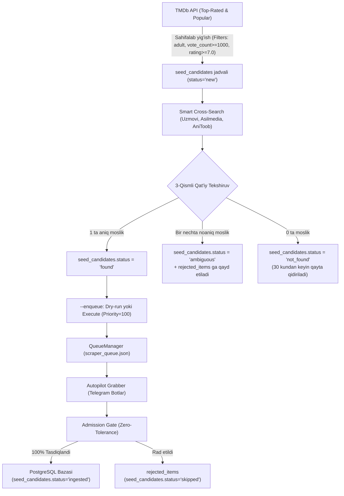

# TMDb Top Seed Ingestor (Oltin Kolleksiya) — Qo'llanma

Ushbu hujjat Kinochi loyihasida ma'lumotlar bazasini 0 dan tozalab yangilanganda, TMDb (The Movie Database) reytingi yuqori va eng ommabop jahon filmlari hamda seriallarini O'zbek manbalaridan (Uzmovi, Asilmedia, AniToob, Animeelar) avtomatik qidirib, tartibli va sifatli tarzda bazaga yuklash tizimi (Seed Ingestor) bo'yicha to'liq qo'llanmadir.

---

## 1. Arxitektura va Asosiy Qoidalar



### Muhit va Xavfsizlik Qoidalari:
1. **To'g'ridan-to'g'ri bazaga yozmaslik**: Ingestor hech qachon `movies`, `series`, `seasons`, `episodes`, `translations` jadvallariga to'g'ridan-to'g'ri insert qilmaydi. U faqat `seed_candidates`, `rejected_items` va `QueueManager` navbatiga yozadi. Kontentni nashr etish faqat va faqat **Admission Gate** tomonidan amalga oshiriladi.
2. **Qat'iy 3-qismli moslik qoidasi**:
   - **Sarlavha**: Tozalangan o'zak slug (`to_slug`, `to_stem_slug`) mos kelishi shart.
   - **Chiqqan yili**: Film yili TMDb yili bilan 1 yildan ko'p farq qilmasligi shart (remeyklar adashib ketmasligi uchun).
   - **Qism raqami**: Sikvel va original qism raqamlari (`extract_part_number`) qat'iy teng bo'lishi shart ("Avatar 2" hech qachon "Avatar 1" ga mos kelmaydi).
3. **Noaniqlikni nazorat qilish**: Bir nechta nomzod mos kelsa, tizim hech qachon birinchisini o'zboshimchalik bilan tanlamaydi. U `status='ambiguous'` qilinadi va admin tekshirishi uchun `rejected_items` ga yoziladi.

---

## 2. Konfiguratsiya Parametrlari

Barcha sozlamalar `backend/app/core/config.py` va `scraper/seed_config.py` orqali boshqariladi hamda `.env` orqali o'zgartirilishi mumkin:

| Parametr | Standart Qiymat | Tavsif |
|---|---|---|
| `SEED_MOVIE_TARGET` | `1000` | TMDb dan yig'iladigan filmlar soni |
| `SEED_TV_TARGET` | `500` | TMDb dan yig'iladigan seriallar soni |
| `SEED_INCLUDE_SERIES` | `false` | Seriallarni ham urug'lantirish (standart: faqat filmlar) |
| `SEED_MIN_VOTE_COUNT` | `1000` | Minimal ovozlar soni (kam tanilgan filmlarni chetlatish) |
| `SEED_MIN_RATING` | `7.0` | Minimal TMDb reytingi (faqat durdona asarlar) |
| `SEED_EXCLUDE_ADULT` | `true` | Kattalar uchun (18+) filmlarni chetlatish |
| `SEED_BATCH_SIZE` | `20` | Bitta qidiruv yoki navbatga qo'yish siklidagi elementlar soni |
| `SEED_NOT_FOUND_RETRY_DAYS` | `30` | Topilmagan filmlarni qayta qidirish oraliq muddati (kun) |
| `SEED_PRIORITY` | `100` | Navbatdagi eng yuqori ustuvorlik darajasi |
| `SEED_SEARCH_DELAY_SECONDS`| `1.0` | Manbalar o'rtasidagi so'rov tanaffusi (bloklanmaslik uchun)|

### Anime Yo'naltirish (Routing):
- Agar TMDb janrlarida `Animation` (ID 16) bo'lsa HAMDA `original_language == 'ja'` bo'lsa:
  -> Qidiruv **AniToob** va **Animeelar** manbalariga yo'naltiriladi.
- Aks holda:
  -> Qidiruv **Uzmovi** va **Asilmedia** manbalariga yo'naltiriladi.

---

## 3. Foydalanish (CLI Buyruqlari)

Barcha amallarni `scraper/tmdb_top_ingestor.py` orqali yoki `start.bat` menyusidan boshqarish mumkin:

### A) Nomzodlarni TMDb dan yig'ish:
```powershell
backend\.venv\Scripts\python.exe scraper/tmdb_top_ingestor.py --build-seeds
```
*TMDb Top Rated va Popular ro'yxatlarini sahifalab, filtrlardan o'tgan filmlarni `seed_candidates` jadvaliga `status='new'` qilib saqlaydi. Takroriy chaqirilganda avvalgi yozuvlarni buzmaydi (idempotent).*

### B) O'zbek manbalaridan qidirish:
```powershell
backend\.venv\Scripts\python.exe scraper/tmdb_top_ingestor.py --search --limit 20
```
*Yangi nomzodlarni Uzmovi, Asilmedia yoki AniToob saytlaridan qidiradi, 3-qismli tekshiruvdan o'tkazadi va `found`, `ambiguous` yoki `not_found` holatiga o'tkazadi.*

### C) Navbatga qo'yish (Sinov / DRY-RUN):
```powershell
backend\.venv\Scripts\python.exe scraper/tmdb_top_ingestor.py --enqueue --limit 20
```
*Standart holatda hech narsani o'zgartirmaydi. Qaysi kinolar navbatga qo'shilishi mumkinligini ekranga chiqaradi.*

### D) Navbatga qo'yish (Haqiqiy / EXECUTE):
```powershell
backend\.venv\Scripts\python.exe scraper/tmdb_top_ingestor.py --enqueue --limit 20 --execute
```
*Topilgan kinolarga to'liq TMDb ma'lumotlarini (poster, treyler, aktyorlar, tavsif) biriktirib, `scraper_queue.json` ga `priority=100` bilan kiritadi va nomzodni `status='queued'` ga o'tkazadi.*

### E) Statistika:
```powershell
backend\.venv\Scripts\python.exe scraper/tmdb_top_ingestor.py --stats
```

---

## 4. `start.bat` Boshqaruv Menyusi

`start.bat` fayliga quyidagi yangi bo'limlar kiritilgan:
- `14) TMDb Top Seed nomzodlarini yig'ish (--build-seeds)`
- `15) O'zbek manbalaridan nomzodlarni qidirish (--search)`
- `16) Navbatga qo'yish: DRY-RUN (sinov rejimi)`
- `17) Navbatga qo'yish: EXECUTE (haqiqiy navbatga kiritish - "YES" tasdig'i bilan)`
- `18) TMDb Seed statistikasini ko'rish (--stats)`
- `19) Media va Seed holatlarini ko'rikdan o'tkazish (Faqat DRY-RUN ko'rik)`

---

## 5. Pilot Reja (Bosqichma-bosqich Sinov)

Bazani toza boshlashda tavsiya etiladigan xavfsiz qadamlar:

1. **1-Qadam (Tekshiruv)**:
   - `start.bat` menyusidan `18` ni tanlab, joriy statistikani ko'ring.
2. **2-Qadam (Nomzodlarni yig'ish)**:
   - `start.bat` menyusidan `14` ni bosing. 1000 ta eng sara film nomzodlari `seed_candidates` jadvaliga yig'iladi.
3. **3-Qadam (Dastlabki 20 ta filmni qidirish)**:
   - `15` ni tanlab, limitga `20` kiriting. Tizim eng mashhur 20 ta filmni O'zbek saytlaridan qidiradi.
4. **4-Qadam (Quruq sinov)**:
   - `16` (DRY-RUN) orqali topilgan filmlarni ko'rib chiqing.
5. **5-Qadam (Navbatga chiqarish)**:
   - `17` ni tanlang va `YES` deb yozing. Filmlar navbatga tushadi.
6. **6-Qadam (Grabberni ishga tushirish)**:
   - Grabber ushbu filmlarni Telegram botdan yuklaydi, Admission Gate ularni to'liq tekshirib bazaga kiritadi va `seed_candidates.status='ingested'` qiladi.

---

## 6. Ma'lum Cheklovlar va Tavsiyalar (Known Limits)

1. **Saytlar Qidiruv Sifati**: Ayrim saytlar (masalan Uzmovi yoki Asilmedia) sarlavhalarda imlo xatolariga yo'l qo'ygan bo'lishi mumkin. Tizimning o'zbekcha stem va lotin-kirill transliteratsiyasi 90%+ holatda ularni to'g'ri topadi. Qolganlari `not_found` yoki `ambiguous` ga tushadi va admin paneldan qayta qidirilishi mumkin.
2. **TMDb Rate Limit**: TMDb API ga daqiqasiga 40 ta so'rov chegarasi mavjud. Bizning `TMDbRateLimiter` va `Retry-After (429)` himoyasi ushbu cheklovni avtomatik boshqaradi.
3. **Xavfsiz Reset**: `scripts/reset_media.py` faqat 3 ta guard (`--execute`, `--confirm YES`, `APP_ENV != production`) orqali ishlaydi va `seed_candidates` dagi `not_found` yozuvlariga tegmaydi (qayta-qayta foydasiz so'rovlarni cheklash uchun).
