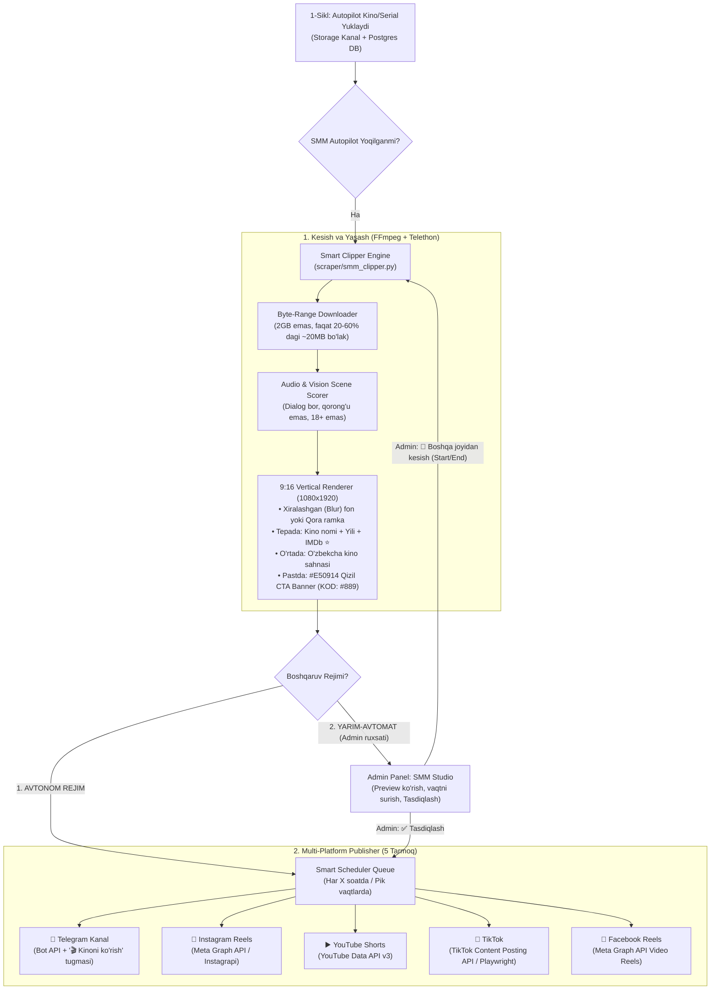

# PRD: SMM & Video Clipping Autopilot (Cycle 2 Automation)

- **Loyiha:** MediaPlus (Kinochi Ecosystem)
- **Hujjat turi:** MVP Product Requirements Document (PRD) & 8-Axis Architecture Spec
- **Sana:** 2026-11-18
- **Holati:** DRAFT (Foydalanuvchi tasdig'i kutilmoqda)

---

## 1. Executive Summary & Working Backwards (Amazon PR/FAQ)

### Press Release (Kelajakdagi natija ko'rinishi)
**MediaPlus "SMM Video Autopilot" (2-sikl) tizimini ishga tushirdi:** Endi loyihaning 1-sikli (Autopilot orqali kino yoki serial yuklash) yakunlanishi bilanoq, 2-sikl avtomatik tarzda Storage kanaldagi haqiqiy o'zbekcha dublyajli kinodan eng qiziqarli 30–55 soniyalik dramatik sahnani (2 GB videoni to'liq tortmasdan, byte-range oqimi orqali) kesib oladi. Uni `1080x1920` (9:16) vertikal formatga solib, tepasiga kino nomi + IMDb reytingini, pastiga esa Cinematic Red (`#E50914`) plashkada **"Kino kodi: #889 | Bot: @..."** yozuvini tushiradi va tayyor videoni 5 ta tarmoqqa (**Telegram kanal, Instagram Reels, YouTube Shorts, TikTok, Facebook Reels**) joylaydi. Admin tizimni **2 xil rejimda** boshqara oladi: **100% Avtonom** (inson aralashuvisiz jadval bo'yicha chiqarish) yoki **Yarim-Avtomat** (Admin Panelda tayyor klipni ko'rib, 1-klik bilan tasdiqlash yoki sekundlarini tahrirlash).

### 3 ta Eng Qiyin Savol (Tough FAQs)
1. **Savol: Storage kanaldagi kino hajmi 1.5 GB – 3.5 GB bo'lsa, har bitta 45 soniyalik Reels uchun 2 GB faylni serverga tortib kesish server diskini va internet trafigini o'ldirmaydimi?**
   - **Javob:** Yo'q. Biz `video_verifier.py` da sinovdan o'tgan **Sparse MP4 `moov` atom + Telethon `iter_download(offset=..., limit=...)`** texnologiyasini kengaytiramiz. MP4 faylning faqat `moov` indeks jadvali (fayl boshi yoki oxiridagi ~5 MB) o'qilib, tanlangan 45 soniyalik timecode'ning aniq byte-offset diapazoni hisoblanadi va Telegram'dan faqat o'sha **~15–25 MB** bo'lak tortib olinadi. 2 GB kino hech qachon to'liq yuklanmaydi.
2. **Savol: Kino ichida zerikarli suhbat, qorong'u kadr yoki bosh/oxirgi titrlar tushib qolmasligini qanday kafolatlaymiz?**
   - **Javob:** Kesish **3 bosqichli "Smart Scene Detector"** orqali amalga oshadi:
     1. Kirish (0%–15% — studiya zastavkalari) va chiqish (85%–100% — spoyler yakun va titrlar) hududlari qat'iyan bloklanadi. Faqat **20%–75%** oralig'idan olinadi.
     2. Tanlangan bo'lakda audio energiya (`FFmpeg astats / silencedetect` — baland dialog, emotsiya yoki harakat ovozi borligi, sukut emasligi) hamda kadr yorqinligi (`min_brightness >= 25`) tekshiriladi.
     3. Yarim-avtomat rejimda tizim **3 xil vaqtdan (masalan: 25%, 45%, 65%)** nomzod kesma tayyorlaydi yoki admin 1 soniyada vaqt oralig'ini (`00:34:10 - 00:34:55`) o'zgartira oladi.
3. **Savol: Instagram, TikTok, YouTube va Facebook API lari tez-tez bloklaydi yoki token muddati tugaydi. Birorta tarmoq xato bersa, qolganlari nima bo'ladi?**
   - **Javob:** Har bir platforma **Mustaqil Adapter (Per-Platform Isolation)** sifatida ishlaydi (`telegram_status`, `instagram_status`, `youtube_status`, `tiktok_status`, `facebook_status`). Agar TikTok tokeni eskirgan bo'lsa, Telegram, Instagram va YouTube ga post ketaveradi, TikTok esa `failed_auth` holatiga tushib, Admin Panelda qizil ogohlantirish va **"Qayta yuborish (Retry)"** tugmasini chiqaradi.

---

## 2. 8-Axis Deep Evaluation Matrix

| # | O'lchov (Axis) | Tahlil va Qaror |
|---|---|---|
| **1** | **Problem & Value** | Kino bazaga yuklangandan keyin uni ommaga tanitish uchun har safar qo'lda video qirqish, CapCut'da shablon qo'yish va 5 ta tarmoqqa bittalab yuklash kuniga 2–4 soat vaqt oladi. Bu sikl avtomatlashtirilsa, organik trafik (botga keladigan yangi obunachilar) 100% passiv oqimga aylanadi. |
| **2** | **Target Persona & UX** | **Admin (Xoja):** Admin Panelda (`/smm` yoki Scraper ichidagi yangi tab) bitta kalit (`Avtonom` ↔ `Yarim-Avtomat`), navbatdagi kliplar premyerasi (videopleyer bilan), har bir tarmoq holati (✅/⏳/❌) va vaqt jadvali. **Tomoshabin:** Reels/Shorts ko'rayotganda aniq kino nomi, IMDb reytingi va qizil plashkada `#KOD` ni ko'radi -> botga kirib kodni yozadi. |
| **3** | **Infrastructure & Cost** | Render (Web) serverini FFmpeg bilan qotirmaslik uchun video kesish va render qilish `scraper/` (Autopilot worker) jarayonida bajariladi. Vaqtinchalik `.mp4` kliplar tarmoqlarga yuklab bo'lingach (yoki Telegram Storage'ga arxivlangach), diskdan o'chiriladi (`temp cleanup`). Disk sarfi < 200 MB. |
| **4** | **Performance & Latency** | Byte-range qirqish: 1 ta 45s klipni tortish (~20 MB) = 3–5 soniya; FFmpeg `1080x1920` (H.264 `ultrafast`/`veryfast` preset) renderlash = 8–15 soniya. Jami 1 ta kino uchun klip tayyorlash ~20 soniya oladi. |
| **5** | **Edge Cases & Failures** | • **Copyright Music:** Musiqali sahna tushib qolsa, opsional `"Copyright Shield"` (fonga +2% tezlik `atempo=1.02` va juda past darajada ambient ohang qo'shish) funksiyasi. <br>• **Rate Limits:** YouTube API kunlik kvotasi (10,000 unit ≈ 6 ta video upload). Kunlik limit tugasa, navbat ertangi kunga avtomatik suriladi. <br>• **18+ / Qonli kadr:** Gemini Vision Gate kesilgan 3 ta kadrni tekshirib, `nsfw/gore` bo'lsa boshqa sahnani tanlaydi. |
| **6** | **Alternatives** | Tashqi pullik servislar (OpusClip, Repurpose.io — oyiga $50–$150) o'zbek tilini tushunmaydi va Telegram Storage bilan to'g'ridan-to'g'ri byte-range ishlay olmaydi. O'zimizning `FFmpeg + Telethon + Gemini Vision` yechimimiz $0 qo'shimcha xarajat bilan ishlaydi. |
| **7** | **Reality Check** | Loyihada allaqachon `Telethon` userbot, `VideoVerifier` (sparse MP4 downloading + OpenCV), `Gemini Vision` va `Admin Panel` mavjud. Yangi tizim mavjud poydevor ustiga toza modul sifatida quriladi. |
| **8** | **Verdict** | ** Lean & Modular MVP** — 4 ta kichik, tekshiriladigan fazada (Slice) qurish. |

---

## 3. Tizim Arxitekturasi va Ishlash Oqimi (Architecture Flow)



---

## 4. Video Shablon Standarti (Cinematic Red 9:16 Layout)

Loyiha qonuniga (**Cinematic Red Design Standard Law**) qat'iy amal qilinadi:
- **O'lcham:** `1080 x 1920 px` (9:16 Full HD Vertical), `30 FPS`, `H.264 + AAC`.
- **Davomiyligi:** Default `35–50 soniya` (Admin sozlamalarda `15s` dan `90s` gacha o'zgartira oladi).
- **Vizual Qatlamlar (`FFmpeg filter_complex`):**
  1. **Fon (Background):** Asl kadrning kattalashtirilib xiralashtirilgan (`boxblur=20:10`, qoraytirilgan `brightness=-0.3`) nusxasi — ekran bo'sh qolmasligi va dinamik ko'rinishi uchun.
  2. **Tepa qism (Header Banner — Y=200..360):**
     - Kino nomi videoda ko'rsatilmaydi (tomoshabin kod orqali botdan izlashi uchun intriga saqlanadi).
     - Brend nomi: **`MEDIAPLUSBOT`** (oq qalin shriftda) va reyting: **`IMDb: 8.4 / 10`** *(Sariq/oltin rang faqat IMDb balli uchun!)*.
  3. **Markaziy qism (Main Video — Y=420..1380):**
     - Asl 16:9 video (`1080x608` yoki markaziy kadr), chetlari nafis soyali.
  4. **Pastki qism (CTA Footer — Y=1440..1720):**
     - **Primary Red (`#E50914`)** tugma/plashka: **`KINO KODI: #889`**
     - Pastida izoh: **`Telegram bot: @kinochi_mvp_bot`** (Instagram/TikTok/YouTube uchun bot manzili).

---

## 5. Ikki Xil Boshqaruv Rejimi (Dual-Mode Governance)

Admin Panelda bitta asosiy pereklyuchatel (Switch) va qoidalar bo'ladi:

### A) Yarim-Avtomat Rejim (`SEMI_AUTO` — Default, Xavfsiz)
1. Autopilot yangi kino/serial yuklaganda (yoki Admin "Bazadagi kinodan klip yasa" tugmasini bosganda), tizim klipni tayyorlab **Telegram Storage/Draft** ga yuklaydi va holatini `waiting_approval` qiladi.
2. Admin Panelda (**SMM Autopilot** sahifasida) tayyor 9:16 videoni darhol brauzerning o'zida ko'rish (play qilish) mumkin:
   - **✅ Tasdiqlash & Navbatga qo'yish:** Klip rejalashtirilgan vaqt jadvaliga (`scheduled`) tushadi.
   - **⚡ Hozirning o'zida chiqarish (Publish Now):** Darhol tanlangan 5 ta tarmoqqa ketadi.
   - **✂️ Qayta kesish (Re-Cut):** Agar sahna yoqmasa, Admin `Boshlanish daqiqasi: [24:10]`, `Davomiyligi: [45s]` deb yozadi (yoki `"Boshqa tasodifiy sahna"` tugmasini bosadi) — tizim 15 soniyada yangi klip yasab beradi.
   - **✏️ Matnni tahrirlash:** Post ostidagi caption va hashtaglarni o'zgartirish.

### B) To'liq Avtonom Rejim (`FULL_AUTO` — Zero-Touch)
1. Admin rejimni `FULL_AUTO` ga o'tkazadi va kunlik kvota/jadvalni belgilaydi (masalan: *"Kuniga 6 ta post: soat 09:00, 12:00, 15:00, 18:00, 20:30, 22:30 da"*).
2. Autopilot kino yuklashi bilan klip yasaladi va avtomatik ravishda eng yaqin bo'sh slota (`scheduled_at`) biriktiriladi.
3. Agar navbatda yangi yuklangan kino qolmasa, tizim **Bazadagi eng yuqori reytingli, lekin hali SMM ga chiqmagan kinolarni** (`movies` / `series` jadvalidan) o'zi tanlab, klip yasab chiqarishda davom etadi! (Ya'ni SMM hech qachon to'xtab qolmaydi).

---

## 6. Baza Sxemasi (Taklif etilayotgan yangi jadvallar — Tasdiqlash uchun)

`Parameter / Schema Law` qoidasiga binoan, bazaga faqat quyidagi **2 ta yangi jadval** qo'shishni taklif qilaman (mavjud `movies` va `series` jadvallariga zarar yetkazmasdan):

### 1. `smm_clip_jobs` (Kesilgan videolar va postlar navbati)
- `id`: Primary Key
- `media_type`: `"movie"` | `"series"`
- `media_id`: Kino ID (`movies.id`) yoki Serial ID (`series.id`)
- `movie_code`: Kino kodi (masalan `889` yoki `S1122`)
- `title`: Kino/serial nomi
- `source_chat_id` & `source_message_id`: Storage kanaldagi video manzili
- `start_sec` & `duration_sec`: Videoning qaysi soniyasidan qancha kesilgani (masalan `1450s`, `45s`)
- `clip_storage_message_id`: Tayyor 9:16 klipning Storage/Draft kanaldagi xabar ID si (server diskini band qilmaslik uchun!)
- `caption`: AI yoki shablon tomonidan yozilgan tayyor post matni + hashtaglar (`#kino #uzbekkino #tarjimakinolar ...`)
- `status`: `"generating"` | `"waiting_approval"` | `"scheduled"` | `"publishing"` | `"completed"` | `"failed"` | `"rejected"`
- `scheduled_at`: Qachon chiqishi kerakligi (`TIMESTAMP`)
- `platforms_status`: `JSONB` — 5 ta tarmoqning har biri bo'yicha aniq holat va post URL/ID:
  ```json
  {
    "telegram":  {"enabled": true, "status": "published", "post_id": "1042", "error": null},
    "instagram": {"enabled": true, "status": "published", "post_id": "17982...", "error": null},
    "youtube":   {"enabled": true, "status": "pending",   "post_id": null, "error": null},
    "tiktok":    {"enabled": true, "status": "failed",    "post_id": null, "error": "Token expired"},
    "facebook":  {"enabled": true, "status": "published", "post_id": "99281...", "error": null}
  }
  ```
- `created_at`, `updated_at`

### 2. `smm_settings` (yoki `system_settings` ichida konfiguratsiya)
- `mode`: `"SEMI_AUTO"` | `"FULL_AUTO"`
- `clip_duration_sec`: Default `45`
- `daily_limit`: Kuniga nechta post (default `6`)
- `schedule_hours`: `["09:00", "12:00", "15:00", "18:00", "20:30", "22:30"]`
- `auto_pick_from_catalog`: Yangi kino bo'lmasa eski TOP kinolardan olsinmi (`true`/`false`)
- `enabled_platforms`: `["telegram", "instagram", "youtube", "tiktok", "facebook"]`
- `bot_username`: Shablon pastiga yoziladigan bot manzili (default `@kinochi_mvp_bot`, nomi `Mediaplusbot`)
- `telegram_channel_id`: Post chiqadigan ommaviy Telegram kanal ID si
- `copyright_shield`: Audio pitch/speed himoyasi (`true`/`false`)

---

## 7. 5 ta Ijtimoiy Tarmoq Integratsiya Mexanizmi

| Platforma | Qanday ulanadi (Texnik yechim) | Afzalligi / Talabi |
|---|---|---|
| **1. Telegram Kanal** | Mavjud Bot API (`sendVideo`) + pastida `🎬 Kinoni tomosha qilish` (`https://t.me/<bot>?start=889`) inline tugmasi. | 100% tayyor, limit yo'q, eng yuqori konversiya (to'g'ridan-to'g'ri botga o'tadi). |
| **2. YouTube Shorts** | Rasmiy **YouTube Data API v3** (`videos.insert`, OAuth2 `refresh_token` bilan). Sarlavhaga `#Shorts` qo'shiladi. | Rasmiy API, juda barqaror, 1 marta Google Cloud OAuth token olinsa yillab avtomat ishlaydi. |
| **3. Instagram Reels** | **Meta Graph API** (Instagram Professional/Creator akkaunt uchun `media` -> `REELS` -> `media_publish`). *(Zaxira varianti: `instagrapi` mobil API).* | Rasmiy Meta Graph API orqali akkaunt bloklanmaydi (60 kunlik long-lived token avtomatik yangilanib turadi). |
| **4. Facebook Reels** | **Meta Graph API** (Facebook Page Video Reels API — Instagram bilan bitta Meta App ichida ishlaydi!). | Instagram ulandimi, Facebook Page ham bitta token bilan avtomatik ishlaydi. |
| **5. TikTok** | **TikTok Content Posting API** (Direct Post OAuth2) *yoki* `tiktok-uploader` (Cookie/Playwright headless session). | Ikkala usul ham qo'llab-quvvatlanadi: rasmiy developer app bo'lsa API, bo'lmasa brauzer `cookies.txt` orqali. |

---

## 8. MVP Qurish Bosqichlari (Slices Roadmap)

Katta tizimni xavfsiz va har bir qadamini ko'z bilan ko'rib tekshirish uchun **4 ta Slice (bosqich)** ga bo'lamiz:

- **Slice 1 (Core Clipper & Vertical Renderer Engine):**
  - Storage kanaldagi o'zbekcha kinodan byte-range bilan 45 soniyalik eng yaxshi sahnani tortish (`smm_clipper.py`).
  - `FFmpeg` orqali 9:16 (`1080x1920`) Cinematic Red shablonni (Blur fon + Kino nomi + IMDb + `#E50914` Kino kodi plashkasi) yig'ish va bitta haqiqiy kinoda test qilib ko'rsatish.
- **Slice 2 (Database, Backend API & Telegram Autoposter):**
  - `smm_clip_jobs` jadvali (Alembic migratsiya), Backend CRUD + Scheduler endpointlari, hamda 1-chi tarmoq — **Telegram ommaviy kanalga** inline tugma bilan post yuborish.
- **Slice 3 (Admin Panel "SMM Studio" UI — 2 xil rejim):**
  - Admin Panelda (`http://localhost:3001/smm` yoki Scraper ichida) `Avtonom / Yarim-Avtomat` boshqaruv paneli, tayyor klipni ko'rish (video preview), vaqtni/sekundni tahrirlash (`Re-cut`), tasdiqlash va jadvalni boshqarish.
- **Slice 4 (Instagram, Facebook, YouTube Shorts, TikTok Publishers):**
  - 4 ta tashqi tarmoq adapterlarini (`publishers/instagram.py`, `youtube.py`, `facebook.py`, `tiktok.py`) ulash, tokenlarni Admin Paneldan kiritish oynasi va xatoliklarni qayta urinish (`Retry`) mexanizmi.
